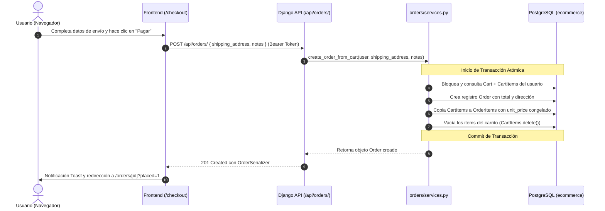
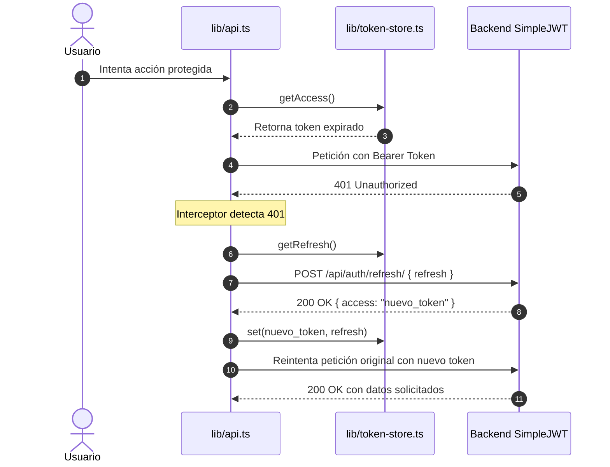

# 🧠 Cerebro del Proyecto: MonitorX & E-Commerce

> [!abstract] **Propósito de este documento**
> Este archivo actúa como el **Map of Content (MOC)** y el **Second Brain** del repositorio.  
> Diseñado para que cualquier desarrollador o IA pueda entender la arquitectura completa y navegar **directamente al archivo exacto** que necesita consultar o modificar, sin tener que inspeccionar código a ciegas.

---

## 🗺️ Mapa de Contenidos (MOC)
- [[#1. Visión General y Arquitectura]]
- [[#2. Guía de Despacho Rápido: "¿Dónde toco si quiero cambiar X?"]]
- [[#3. Módulo E-Commerce Frontend (Next.js 16)]]
- [[#4. Módulo E-Commerce Backend (Django 5.2 + DRF)]]
- [[#5. Módulo Monitoring Agent (FastAPI / Collectors)]]
- [[#6. Módulo MonitorX (FastAPI + Dashboard)]]
- [[#7. Flujos de Datos Clave (Data Pipelines)]]
- [[#8. Comandos de Operación y Desarrollo]]

---

## 1. Visión General y Arquitectura

El proyecto es un **monorepo de portafolio** compuesto por dos ecosistemas independientes pero interconectados mediante un agente desacoplado:

```mermaid
flowchart TD
    subgraph CLIENTES ["🌐 Clientes Externos"]
        UserBrowser["Navegador Usuario (Cliente)"]
        AdminBrowser["Navegador Admin (Dashboard)"]
    end

    subgraph ECOMMERCE ["🛒 E-Commerce Platform"]
        FE["Next.js Frontend (Port 3000)"]
        Nginx["Nginx Reverse Proxy (Port 80/443)"]
        Django["Django REST API (Port 8000)"]
        PostgresEco[("PostgreSQL 16 (ecommerce_db)")]
        RedisEco[("Redis 7 (Cache / Broker)")]
        CeleryWorker["Celery Worker (Tareas en background)"]
    end

    subgraph AGENT_SYS ["📡 Monitoring Agent"]
        Agent["Monitoring Agent (FastAPI + psutil)"]
    end

    subgraph MONITORX ["📊 MonitorX Observability"]
        FastAPI_MX["MonitorX API (FastAPI)"]
        PostgresMX[("PostgreSQL 16 (monitorx_db)")]
        DashMX["MonitorX Dashboard (React + Vite)"]
    end

    %% Conexiones E-Commerce
    UserBrowser -->|HTTP| FE
    FE -->|API Calls| Django
    Nginx -->|/api/| Django
    Django --> PostgresEco
    Django --> RedisEco
    CeleryWorker --> RedisEco
    CeleryWorker --> Django

    %% Conexiones Agente (Push Metrics)
    Agent -.->|Lee Access Logs JSON| Nginx
    Agent -.->|Health Check GET /api/health| Django
    Agent -.->|Consulta stats / pg_monitor| PostgresEco
    Agent -.->|PING / Info| RedisEco
    Agent ==>|POST /api/v1/metrics (Push HTTPS + API Key)| FastAPI_MX

    %% Conexiones MonitorX
    FastAPI_MX --> PostgresMX
    AdminBrowser --> DashMX
    DashMX -->|WebSocket / REST| FastAPI_MX
```

### 🛡️ Reglas Sagradas de Arquitectura (Inviolables)
1. **Aislamiento Absoluto de Bases de Datos:** MonitorX **jamás** se conecta a la base de datos del E-Commerce. Solo recibe métricas enviadas por el `monitoring-agent` vía HTTPS.
2. **Modelo Push:** El agente es el que empuja datos (`POST /api/v1/metrics`) hacia MonitorX con autenticación por `X-API-Key`. MonitorX no hace scraping directo al backend.
3. **Seguridad en Docker:** Cada servicio en su propio contenedor. PostgreSQL y Redis **no publican puertos al host** (`ports:`); solo se comunican en redes internas (`internal`).
4. **Logs en JSON:** Nginx genera logs de acceso en formato JSON estructurado en un volumen compartido para que el agente los analice en tiempo real sin overhead.
5. **Separación Frontend:** Cero lógica de negocio pesada en componentes de vista; toda la interacción con la API se delega a `lib/services.ts`, hooks de SWR en `lib/hooks.ts` y normalizadores en `lib/normalize.ts`.

---

## 2. Guía de Despacho Rápido: "¿Dónde toco si quiero cambiar X?"

Usa esta tabla para localizar de inmediato el archivo o módulo que debes modificar:

| Objetivo / Acción | Frontend (Dónde ir) | Backend (Dónde ir) |
|---|---|---|
| **Autenticación (Login / Registro / Tokens)** | [`components/auth/login-form.tsx`](file:///c:/Users/alanv/Downloads/MonitorX/ecommerce/frontend/components/auth/login-form.tsx)<br>[`lib/token-store.ts`](file:///c:/Users/alanv/Downloads/MonitorX/ecommerce/frontend/lib/token-store.ts)<br>[`components/providers/auth-provider.tsx`](file:///c:/Users/alanv/Downloads/MonitorX/ecommerce/frontend/components/providers/auth-provider.tsx) | [`users/views.py`](file:///c:/Users/alanv/Downloads/MonitorX/ecommerce/backend/users/views.py)<br>[`users/serializers.py`](file:///c:/Users/alanv/Downloads/MonitorX/ecommerce/backend/users/serializers.py)<br>`CustomTokenObtainPairSerializer` |
| **Modelos de Usuario / Roles / Permisos** | [`components/admin/admin-users.tsx`](file:///c:/Users/alanv/Downloads/MonitorX/ecommerce/frontend/components/admin/admin-users.tsx) | [`users/models.py`](file:///c:/Users/alanv/Downloads/MonitorX/ecommerce/backend/users/models.py)<br>[`users/permissions.py`](file:///c:/Users/alanv/Downloads/MonitorX/ecommerce/backend/users/permissions.py) (`IsAdmin`, `IsOwnerOrAdmin`) |
| **Catálogo de Productos (Listado / Filtros / Búsqueda)** | [`components/shop/shop-catalog.tsx`](file:///c:/Users/alanv/Downloads/MonitorX/ecommerce/frontend/components/shop/shop-catalog.tsx)<br>[`components/shop/product-card.tsx`](file:///c:/Users/alanv/Downloads/MonitorX/ecommerce/frontend/components/shop/product-card.tsx)<br>[`app/shop/page.tsx`](file:///c:/Users/alanv/Downloads/MonitorX/ecommerce/frontend/app/shop/page.tsx) | [`products/views.py`](file:///c:/Users/alanv/Downloads/MonitorX/ecommerce/backend/products/views.py)<br>[`products/filters.py`](file:///c:/Users/alanv/Downloads/MonitorX/ecommerce/backend/products/filters.py)<br>[`products/models.py`](file:///c:/Users/alanv/Downloads/MonitorX/ecommerce/backend/products/models.py) |
| **Detalle de Producto y Stock** | [`components/shop/product-detail.tsx`](file:///c:/Users/alanv/Downloads/MonitorX/ecommerce/frontend/components/shop/product-detail.tsx)<br>[`app/product/[id]/page.tsx`](file:///c:/Users/alanv/Downloads/MonitorX/ecommerce/frontend/app/product/[id]/page.tsx) | [`products/views.py`](file:///c:/Users/alanv/Downloads/MonitorX/ecommerce/backend/products/views.py) (`ProductDetailView`) |
| **Categorías** | [`components/admin/admin-categories.tsx`](file:///c:/Users/alanv/Downloads/MonitorX/ecommerce/frontend/components/admin/admin-categories.tsx) | [`categories/models.py`](file:///c:/Users/alanv/Downloads/MonitorX/ecommerce/backend/categories/models.py)<br>[`categories/views.py`](file:///c:/Users/alanv/Downloads/MonitorX/ecommerce/backend/categories/views.py)<br>[`categories/serializers.py`](file:///c:/Users/alanv/Downloads/MonitorX/ecommerce/backend/categories/serializers.py) |
| **Carrito de Compras (Añadir / Cantidad / Eliminar)** | [`components/cart/cart-view.tsx`](file:///c:/Users/alanv/Downloads/MonitorX/ecommerce/frontend/components/cart/cart-view.tsx)<br>[`lib/hooks.ts`](file:///c:/Users/alanv/Downloads/MonitorX/ecommerce/frontend/lib/hooks.ts) (`useCart`) | [`cart/models.py`](file:///c:/Users/alanv/Downloads/MonitorX/ecommerce/backend/cart/models.py)<br>[`cart/views.py`](file:///c:/Users/alanv/Downloads/MonitorX/ecommerce/backend/cart/views.py)<br>[`cart/services.py`](file:///c:/Users/alanv/Downloads/MonitorX/ecommerce/backend/cart/services.py) |
| **Checkout y Creación de Pedidos** | [`components/cart/checkout-form.tsx`](file:///c:/Users/alanv/Downloads/MonitorX/ecommerce/frontend/components/cart/checkout-form.tsx)<br>[`app/checkout/page.tsx`](file:///c:/Users/alanv/Downloads/MonitorX/ecommerce/frontend/app/checkout/page.tsx) | [`orders/services.py`](file:///c:/Users/alanv/Downloads/MonitorX/ecommerce/backend/orders/services.py) (`create_order_from_cart`)<br>[`orders/models.py`](file:///c:/Users/alanv/Downloads/MonitorX/ecommerce/backend/orders/models.py)<br>[`orders/views.py`](file:///c:/Users/alanv/Downloads/MonitorX/ecommerce/backend/orders/views.py) |
| **Historial de Pedidos y Detalles** | [`components/orders/orders-list.tsx`](file:///c:/Users/alanv/Downloads/MonitorX/ecommerce/frontend/components/orders/orders-list.tsx)<br>[`components/orders/order-detail.tsx`](file:///c:/Users/alanv/Downloads/MonitorX/ecommerce/frontend/components/orders/order-detail.tsx) | [`orders/views.py`](file:///c:/Users/alanv/Downloads/MonitorX/ecommerce/backend/orders/views.py)<br>[`orders/serializers.py`](file:///c:/Users/alanv/Downloads/MonitorX/ecommerce/backend/orders/serializers.py) |
| **Panel Admin (CRUD Completo)** | [`components/admin/`](file:///c:/Users/alanv/Downloads/MonitorX/ecommerce/frontend/components/admin/)<br>[`app/admin/layout.tsx`](file:///c:/Users/alanv/Downloads/MonitorX/ecommerce/frontend/app/admin/layout.tsx) | Vistas protegidas con `IsAdmin` en cada app Django |
| **Llamadas HTTP a la API y Tokens** | [`lib/api.ts`](file:///c:/Users/alanv/Downloads/MonitorX/ecommerce/frontend/lib/api.ts) (Interceptor Fetch y Token Refresh) | [`config/exceptions.py`](file:///c:/Users/alanv/Downloads/MonitorX/ecommerce/backend/config/exceptions.py) (Uniform Error Format) |
| **Contratos de Datos / Normalización** | [`lib/normalize.ts`](file:///c:/Users/alanv/Downloads/MonitorX/ecommerce/frontend/lib/normalize.ts) (snake_case ↔ camelCase) | `serializers.py` de cada app |
| **UI Kit / Componentes Reutilizables** | [`components/ui-kit/`](file:///c:/Users/alanv/Downloads/MonitorX/ecommerce/frontend/components/ui-kit/) (`field.tsx`, `modal.tsx`, `pill-button.tsx`, etc.) | N/A |
| **Métricas del Sistema y Nginx** | N/A | [`monitoring-agent/collectors/`](file:///c:/Users/alanv/Downloads/MonitorX/monitoring-agent/collectors/) |
| **Alertas y WebSockets en MonitorX** | [`monitorx/frontend/`](file:///c:/Users/alanv/Downloads/MonitorX/monitorx/frontend/) | [`monitorx/backend/`](file:///c:/Users/alanv/Downloads/MonitorX/monitorx/backend/) |

---

## 3. Módulo E-Commerce Frontend (Next.js 16)

```text
ecommerce/frontend/
├── app/                  # Routing Next.js App Router
│   ├── account/          # Perfil de usuario (/account)
│   ├── admin/            # Panel de control de administración (/admin/*)
│   │   ├── categories/   # Gestión de categorías
│   │   ├── orders/       # Gestión y cambio de estado de órdenes
│   │   ├── products/     # CRUD de productos
│   │   └── users/        # Gestión de permisos y usuarios
│   ├── cart/             # Vista de bolsa de compras (/cart)
│   ├── checkout/         # Formulario de pago y dirección (/checkout)
│   ├── login/            # Inicio de sesión (/login)
│   ├── orders/           # Historial y detalle de pedidos (/orders y /orders/[id])
│   ├── product/[id]/     # Ficha de producto con fotos y stock
│   ├── register/         # Registro de clientes (/register)
│   ├── shop/             # Catálogo completo con buscador y filtros (/shop)
│   ├── layout.tsx        # Layout global con Header, Footer y Providers
│   └── page.tsx          # Landing page principal
├── components/           # Componentes modulares
│   ├── account/          # Vista de cuenta y edición de perfil
│   ├── admin/            # Vistas internas del panel admin
│   ├── auth/             # Formularios de auth (login, register, reset-pwd)
│   ├── cart/             # CartView y CheckoutForm
│   ├── home/             # Hero banner y catálogo de portada
│   ├── layout/           # SiteHeader, SiteFooter, AccountMenu
│   ├── orders/           # OrderDetail y OrdersList
│   ├── providers/        # AuthProvider (estado global sesión), SWR, RequireAuth
│   ├── shop/             # ProductCard, ProductDetail, ShopCatalog
│   └── ui-kit/           # Componentes base (Botones, Modales, Spinners, Campos)
└── lib/                  # Lógica de infraestructura del cliente
    ├── api.ts            # Cliente fetch con auto-refresh de JWT y parser de errores
    ├── config.ts         # URLs del entorno y constantes (NEXT_PUBLIC_API_URL)
    ├── format.ts         # Formateo de monedas, fechas y estados
    ├── hooks.ts          # Hooks reactivos SWR (useProducts, useCart, useOrders...)
    ├── normalize.ts      # Mapeo estricto API Django -> Tipos Frontend
    ├── services.ts       # Métodos de negocio agrupados por dominio
    ├── token-store.ts    # Manejo de JWT en Storage con patrón observable
    ├── types.ts          # Tipos TypeScript compartidos (User, Product, Order, Cart)
    └── utils.ts          # cn() para Tailwind merge
```

### 🔑 Aspectos Clave del Frontend
- **Autenticación Reactiva:** Manejada por `token-store.ts` mediante `useSyncExternalStore`. Si el access token expira, `api.ts` intercepta la respuesta 401, solicita un nuevo token a `/api/auth/refresh/` con el refresh token, lo guarda y reintenta la petición original de forma transparente.
- **Normalización de Datos:** Django utiliza `snake_case` (ej. `phone_number`, `is_staff`, `unit_price`). El frontend normaliza automáticamente en `lib/normalize.ts` hacia `camelCase` (`phone`, `isStaff`, `unitPrice`) aislando la UI de cambios en el backend.
- **Auto-generación de Slugs:** La UI no pide slugs al usuario. Solo envía `name` y el backend se encarga de generar slugs únicos y limpios.

---

## 4. Módulo E-Commerce Backend (Django 5.2 + DRF)

```text
ecommerce/backend/
├── config/               # Configuración central Django
│   ├── settings/         # Configuraciones modulares (base.py, local.py, production.py)
│   ├── exceptions.py     # Exception handler uniforme: {"error": {"code", "message"}}
│   ├── pagination.py     # Paginación estándar de 10 elementos con meta
│   └── urls.py           # Enrutamiento raíz de la API (/api/*)
├── users/                # App de Usuarios y Autenticación
│   ├── models.py         # Custom User con email como USERNAME_FIELD y roles
│   ├── permissions.py    # IsAdmin (role ADMIN o is_staff) e IsOwnerOrAdmin
│   ├── serializers.py    # UserSerializer, CustomTokenObtainPairSerializer, RegisterSerializer
│   └── views.py          # Register, Login, Profile, Logout, PasswordReset
├── categories/           # App de Categorías
│   ├── models.py         # Category con auto-slug en save()
│   ├── serializers.py    # CategorySerializer con validación y auto-slug
│   └── views.py          # CategoryListCreateView (público GET, admin POST)
├── products/             # App de Productos
│   ├── models.py         # Product con category nullable, auto-slug y stock
│   ├── filters.py        # DjangoFilterBackend (categoría, precio_min/max, search)
│   ├── serializers.py    # ProductSerializer con category_name y auto-slug
│   └── views.py          # ProductListCreateView (público GET, admin POST)
├── cart/                 # App de Carrito de Compras
│   ├── models.py         # Cart (1:1 con User) y CartItem (relación con Product)
│   ├── serializers.py    # CartSerializer y CartItemSerializer con subtotales
│   ├── services.py       # Lógica transaccional para agregar/restar productos
│   └── views.py          # CartDetailView, CartItemAddView, CartItemUpdateView
└── orders/               # App de Pedidos
    ├── models.py         # Order (con shipping_address, notes y status) y OrderItem
    ├── serializers.py    # OrderSerializer con items congelados
    ├── services.py       # create_order_from_cart() en atomic transaction
    └── views.py          # OrderListCreateView y OrderDetailView
```

### 🔒 Convención de Errores Uniforme (API Backend)
Todas las respuestas de error siguen estrictamente el estándar:
```json
{
  "error": {
    "code": "validation_error",
    "message": "Descripción legible del error"
  }
}
```

---

## 5. Módulo Monitoring Agent (FastAPI / Collectors)

Ubicación: [`monitoring-agent/`](file:///c:/Users/alanv/Downloads/MonitorX/monitoring-agent/)

> [!info] **Rol del Agente:**  
> Es un daemon ligero en Python que corre en el mismo host/red Docker del E-Commerce.  
> Monitorea la infraestructura sin impactar el rendimiento y envía métricas a MonitorX.

### Colectores Principales (`collectors/`)
1. **System Collector:** CPU, memoria RAM, particiones de disco, I/O de red, uptime (vía `psutil`).
2. **Docker Collector:** Contenedores activos, consumo individual de CPU/RAM, reinicios inesperados (vía Docker Socket en solo lectura).
3. **Nginx HTTP Collector:** Parsea las líneas JSON del access log de Nginx para calcular:
   - Requests por minuto (throughput)
   - Tiempos de respuesta y percentiles (latencia p95, p99)
   - Tasa de errores HTTP 4xx y 5xx.
4. **PostgreSQL Collector:** Conexiones activas, tamaño de BD y queries lentas usando usuario `pg_monitor`.
5. **Redis Collector:** Clientes conectados, memoria utilizada, hits/misses de caché.
6. **Health Checker:** Ejecuta pings periódicos a `GET /api/health` del backend, Celery ping y Postgres check.

---

## 6. Módulo MonitorX (FastAPI + Dashboard)

Ubicación: [`monitorx/`](file:///c:/Users/alanv/Downloads/MonitorX/monitorx/)

### MonitorX Backend (`monitorx/backend/`)
- **FastAPI:** Alto rendimiento asíncrono para ingesta masiva de métricas.
- **PostgreSQL Propia:** Tablas de `servers`, `services`, `metrics`, `alerts`, `events`.
- **Alert Engine:** Motor de reglas en memoria/BD que evalúa umbrales (ej. CPU > 80% durante 3 muestras consecutivas) para evitar falsos positivos (anti-flapping).
- **WebSockets:** Transmisión en tiempo real al dashboard administrativo sin sobrecargar con polling.

### MonitorX Dashboard (`monitorx/frontend/`)
- Panel de control React con Tailwind CSS.
- Gráficos interactivos de series de tiempo con Recharts.
- Sistema de reconocimiento y resolución de incidentes (`ACKNOWLEDGED` / `RESOLVED`).

---

## 7. Flujos de Datos Clave (Data Pipelines)

### A. Flujo de Compra y Creación de Pedido


### B. Flujo de Autenticación con Auto-Refresh


---

## 8. Comandos de Operación y Desarrollo

### Iniciar Servidores Locales (Dev Mode)

#### Backend Django:
```powershell
cd ecommerce\backend
# En Windows con venv:
.\venv\Scripts\python.exe manage.py runserver 8000 --settings=config.settings.local
```

#### Frontend Next.js:
```powershell
cd ecommerce\frontend
npm run dev
# Disponible en: http://localhost:3000
```

### Tareas de Base de Datos y Mantenimiento

```powershell
# Crear migraciones tras tocar models.py:
cd ecommerce\backend
.\venv\Scripts\python.exe manage.py makemigrations --settings=config.settings.local

# Aplicar migraciones:
.\venv\Scripts\python.exe manage.py migrate --settings=config.settings.local

# Cargar datos semilla (4 categorías, 8 productos, usuarios demo):
.\venv\Scripts\python.exe manage.py seed_data --settings=config.settings.local

# Ejecutar tests de cobertura con pytest:
pytest --cov=. --cov-fail-under=80
```

---

## 📚 Documentos Relacionados
- [[TASKS|docs/TASKS.md]] — Plan de ruta y checklist de fases y tareas.
- [[STATUS|docs/STATUS.md]] — Estado actual de la última sesión.
- [[CONVENTIONS|docs/CONVENTIONS.md]] — Guía de estilo, convenciones de código y Git.
- [[CLAUDE|CLAUDE.md]] — Reglas directas para asistentes de IA.
